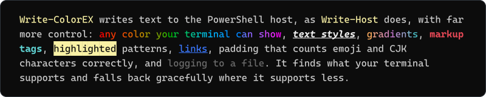
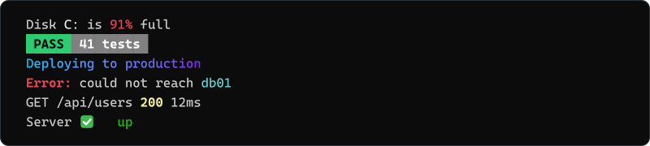

<div align="center">


[](https://www.powershellgallery.com/packages/PSWriteColorEX)
[](https://markusmcnugen.github.io/PSWriteColorEX/)
[](https://github.com/MarkusMcNugen/PSWriteColorEX/blob/main/LICENSE)
[](https://markusmcnugen.github.io/PSWriteColorEX/docs/tutorial/getting-started/)
[](https://markusmcnugen.github.io/PSWriteColorEX/docs/tutorial/getting-started/)

**[Documentation](https://markusmcnugen.github.io/PSWriteColorEX/)** | [Getting started](https://markusmcnugen.github.io/PSWriteColorEX/docs/tutorial/getting-started/) | [Write-ColorEX reference](https://markusmcnugen.github.io/PSWriteColorEX/docs/reference/write-colorex/) | [How-to guides](https://markusmcnugen.github.io/PSWriteColorEX/docs/how-to/)



</div>

---

<details>
<summary><b>Table of contents</b></summary>

- [Features](#features)
- [Quick start](#quick-start)
- [Why PSWriteColorEX](#why-pswritecolorex)
- [Commands](#commands)
- [PWRSWriteColorEX](#pwrswritecolorex)
- [Repository layout](#repository-layout)
- [Building and testing](#building-and-testing)
- [Platforms](#platforms)
- [Wiki](#wiki)
- [Credits](#credits)
- [Use of AI tools](#use-of-ai-tools)
- [License](#license)

</details>

---

## Features

<details open>
<summary><b>What you get</b></summary>

- TrueColor, 256 and 16 colors, chosen to suit the terminal, with a fallback where it has fewer. See [Color modes](https://markusmcnugen.github.io/PSWriteColorEX/docs/explanation/color-modes/) and [Terminal compatibility](https://markusmcnugen.github.io/PSWriteColorEX/docs/reference/terminals/).
- 129 color names in 44 families, hex codes, `rgb()`, `hsl()`, RGB arrays and color numbers. See [Colors](https://markusmcnugen.github.io/PSWriteColorEX/docs/tutorial/colors/).
- [Gradients](https://markusmcnugen.github.io/PSWriteColorEX/docs/tutorial/gradients/) across the text and its background, blended so the steps look even: in eight color spaces, with placed stops, easing curves, bands, repeats and four directions, twenty-one [named gradients](https://markusmcnugen.github.io/PSWriteColorEX/docs/reference/colors-and-names/#named-gradients) such as Sunset and Ocean, and `Get-GradientColor` for a gradient's colors.
- [Markup tags](https://markusmcnugen.github.io/PSWriteColorEX/docs/tutorial/markup/) such as `[bold red]Error:[/]`, patterns colored where they match, and strings split into colored parts.
- Bold, italic, faint, blink, reverse, crossed-out and overlined text, and underlines single, double, curly, dotted or dashed in a color of their own.
- [Links](https://markusmcnugen.github.io/PSWriteColorEX/docs/how-to/write-links/) that terminals open when they are clicked.
- [Padding, centering, cutting and wrapping](https://markusmcnugen.github.io/PSWriteColorEX/docs/tutorial/layout/) that count wide characters as two cells, so columns line up.
- Message helpers and [style profiles](https://markusmcnugen.github.io/PSWriteColorEX/docs/tutorial/profiles/), saved to and read from a JSON file.
- [Themes](https://markusmcnugen.github.io/PSWriteColorEX/docs/how-to/use-a-theme/) that restyle the profiles: Catppuccin, Solarized, Gruvbox, Dracula, Nord, One Dark, Tokyo Night and PowerShell's own colors, and the CSS color names.
- `Show-ColorTable` views of the color names, the text styles, the 256-color chart and the style profiles.
- A [cheat sheet](https://markusmcnugen.github.io/PSWriteColorEX/docs/reference/cheat-sheet/), also in PowerShell's help as `about_PSWriteColorEX`.
- [Colored text as strings](https://markusmcnugen.github.io/PSWriteColorEX/docs/how-to/build-colored-strings/) for other strings, tables and files.
- [Logging to a file](https://markusmcnugen.github.io/PSWriteColorEX/docs/tutorial/logging/), with a time and a level, and transcripts that record each line once.
- `NO_COLOR`, `FORCE_COLOR`, `CLICOLOR`, `CLICOLOR_FORCE` and `TERM=dumb` honored. See [Turn colors off](https://markusmcnugen.github.io/PSWriteColorEX/docs/how-to/turn-colors-off/).
- Pure PowerShell, for Windows PowerShell 5.1 and PowerShell 7, with no dependencies.

</details>

## Quick start

Install the module from the PowerShell Gallery:

```powershell
Install-Module PSWriteColorEX -Scope CurrentUser
```

Then write some color:

```powershell
# Each string is a segment, and each segment takes the next color
Write-ColorEX -Text 'Disk ', 'C:', ' is ', '91%', ' full' -Color Gray, White, Gray, Red, Gray

# Hex codes, styles and a background
Write-ColorEX -Text ' PASS ', ' 41 tests ' -Color Black, White -BackGroundColor '#2ECC71', DarkGray -Bold

# A gradient
Write-ColorEX -Text 'Deploying to production' -Gradient '#00C6FF', '#7B2FF7'

# Markup tags, and a pattern colored where it matches
Write-ColorEX -Markup '[bold red]Error:[/] could not reach [cyan]db01[/]'
Write-ColorEX -Text 'GET /api/users 200 12ms' -Highlight @{ '\b\d{3}\b' = 'bold yellow' }

# Columns that line up, even with emoji
Write-ColorEX -Text 'Server ✅' -AutoPad 12 -NoNewLine; Write-ColorEX -Text 'up' -Color Green
```



The [tutorial](https://markusmcnugen.github.io/PSWriteColorEX/docs/tutorial/getting-started/)
shows all examples with the colors and styles they write.

## Why PSWriteColorEX

`Write-Host` takes one color for the whole call, from the console's 16. PSWriteColorEX keeps the
`Write-Host` way of working, writing to the host, but gives each part of a line its own color and
style, in any color the terminal can show. It checks what the terminal supports, so the same script
looks right in Windows Terminal, in the old Windows console, in a Linux terminal and in a CI log.
It turns colors off when you ask with `NO_COLOR`, and keeps transcripts readable.

## Commands

<details>
<summary><b>All 27 commands</b></summary>

| Command | What it does |
|---|---|
| `Write-ColorEX` | Writes colored and styled text, with layout, markup, highlighting, links and logging |
| `Write-ColorError`, `Write-ColorWarning`, `Write-ColorInfo`, `Write-ColorSuccess`, `Write-ColorCritical`, `Write-ColorDebug` | Write a message with a built-in style |
| `Format-ColorEX` | Returns colored text as strings instead of writing it |
| `Show-ColorTable` | Shows every color name with samples in each color mode, or the text styles, the 256-color chart or the style profiles |
| `Get-GradientColor` | Returns a gradient's colors as RGB arrays, for each of a number of characters or at one place |
| `New-ColorStyle`, `Set-ColorDefault`, `Get-ColorProfiles` | Make styles, set the default style, and list the styles |
| `Export-ColorProfile`, `Import-ColorProfile`, `Remove-ColorProfile` | Save styles to a file, read them back or read a theme, and remove them |
| `Register-ColorName`, `Unregister-ColorName` | Add and remove your own color names |
| `Test-AnsiSupport` | Reports what the terminal supports |
| `Measure-DisplayWidth` | Counts the terminal cells a string takes |
| `Convert-HexToRGB`, `Convert-RGBToANSI8`, `Convert-RGBToANSI4`, `Get-ColorTableWithRGB` | Convert colors and list the color table |
| `Get-LighterRGBColor`, `Get-LighterColorName`, `Get-LighterANSI8Color` | Return a lighter color |
| `Get-ColorContrast` | Returns the contrast ratio of a color on a background, from 1 to 21 |

The [reference](https://markusmcnugen.github.io/PSWriteColorEX/docs/reference/) lists every
parameter of every command.

</details>

## PWRSWriteColorEX

[PWRSWriteColorEX](https://github.com/Variably-Constant/PWRSWriteColorEX) has the same commands,
parameters and output, compiled from Rust with [PWRS](https://github.com/Variably-Constant/PWRS),
for scripts that write a lot. Its major and minor version are this module's, its patch number may
differ, and a test suite holds the two to the same output, escape code for escape code. See
[PWRSWriteColorEX](https://markusmcnugen.github.io/PSWriteColorEX/docs/explanation/pwrswritecolorex/)
in the wiki.

## Repository layout

| Path | Holds |
|---|---|
| `PSWriteColorEX.psd1`, `PSWriteColorEX.psm1` | The module manifest and loader |
| `Public/` | The exported commands |
| `Private/` | The code the commands share |
| `Classes/` | `PSColorStyle` and the classes that build each line |
| `Themes/` | The themes `Import-ColorProfile -Theme` reads, in `Export-ColorProfile`'s format |
| `en-US/` | The `about_PSWriteColorEX` help topic, written from the wiki's cheat sheet |
| `Tests/` | The Pester suites |
| `Examples/` | Example scripts |
| `wiki/` | The documentation site: its pages, and the script that runs every example |
| `.github/readme/` | This README's title, tagline and description images, and the script that draws them from the module's output |

## Building and testing

The module needs no build. The tests use Pester 5 or later:

```powershell
./Tests/Tests-All.ps1 -CodeCoverage:$false
```

The wiki is built with Hugo. Its examples run through the module first, and the run fails when a
page shows output the module does not write:

```powershell
cd wiki
pwsh ./generate.ps1
hugo serve
```

The images at the top of this README are the module's own output, drawn by a script that needs
Python with fontTools:

```powershell
pwsh ./.github/readme/New-ReadmeImage.ps1
```

## Platforms

Windows PowerShell 5.1 and PowerShell 7 on Windows, Linux and macOS. The tests run on all of them
in CI. [Terminal compatibility](https://markusmcnugen.github.io/PSWriteColorEX/docs/reference/terminals/)
lists the colors and styles each terminal and CI system shows.

## Wiki

The [documentation](https://markusmcnugen.github.io/PSWriteColorEX/) has a tutorial, how-to
guides, a reference for every command and parameter, and explanations of how it works. Every
example on it ran through the module, and shows the colors it wrote.

## Credits

Inspired by [PSWriteColor](https://github.com/EvotecIT/PSWriteColor) by Przemyslaw Klys. The
display widths come from the table of the Rust crate
[unicode-width](https://crates.io/crates/unicode-width). The themes take their colors from
Catppuccin, Solarized, Gruvbox, Dracula, Nord, One Dark and Tokyo Night, and eleven named gradients
come from [gradient-string](https://github.com/bokub/gradient-string);
[THIRD-PARTY-NOTICES](https://github.com/MarkusMcNugen/PSWriteColorEX/blob/main/THIRD-PARTY-NOTICES)
credits each with its license. The images at the top of this README draw their letters with
[Cascadia Mono](https://github.com/microsoft/cascadia-code).

## Use of AI tools

The author used Claude (Anthropic) via the Claude Code CLI for code development assistance and
documentation drafting during the preparation of this repository. All design decisions and the
final content were determined by the author. The implementation and the tests were verified
through the Pester suites in PowerShell 7 and Windows PowerShell 5.1, and every example in the wiki
ran through the module.

## License

[MIT](https://github.com/MarkusMcNugen/PSWriteColorEX/blob/main/LICENSE), copyright (c) 2026 Mark
Newton.
